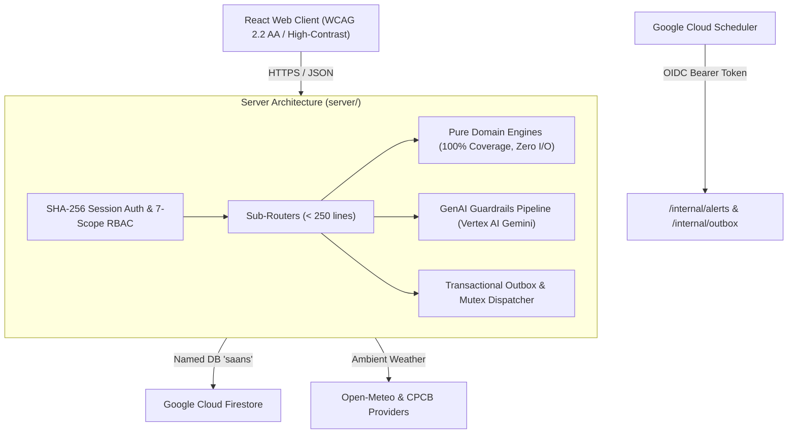
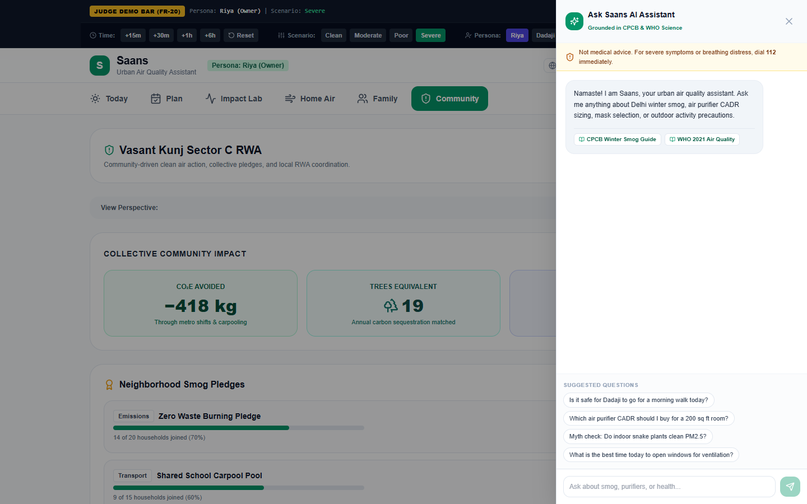

# Saans (साँस) — Urban Air Quality & Winter Smog Assistant

> **One-Line Pitch:** A deterministic, privacy-first environmental health assistant that turns winter smog forecasts into personalized, evidence-grounded daily action plans — separating family exposure from city emissions while enforcing strict safety guardrails and $k$-anonymity.

- **Live URL:** [https://saans-205781654913.asia-south1.run.app](https://saans-205781654913.asia-south1.run.app)
- **Local Dev Server:** `http://localhost:8080`
- **Cloud Run Service:** `saans` in `asia-south1` (GCP Project: `ai-builder-sql-copilot`)
- **Synthetic Demo Personas (Quick Login via Judge Demo Bar):**
  - **Riya (Working Mother / Child with Asthma):** `riya@demo.saans.in` / `Password123!`
  - **Dadaji (Elder with Cardiac Stent):** `dadaji@demo.saans.in` / `Password123!`
  - **Mr. Kulkarni (RWA Society President):** `kulkarni@demo.saans.in` / `Password123!`

---

## 1. The Problem & How Every Clause is Solved

| Problem Clause                          | How Saans Solves It                                                                                                                                             | Implementation File                                                             |
| :-------------------------------------- | :-------------------------------------------------------------------------------------------------------------------------------------------------------------- | :------------------------------------------------------------------------------ |
| **Winter Smog Hazard & Hazardous NAQI** | Computes real-time CPCB NAQI, WHO 15 µg/m³ multiples, and pinpoints micro-meteorological smog drivers (boundary layer inversion, wind stall, biomass burning).  | `server/src/core/aqi.ts`, `server/src/core/smogDrivers.ts`                      |
| **Conflicting Advice & Viral Myths**    | Curates a 40+ entry peer-reviewed knowledge base. Evaluates viral claims (plants, jaggery, steam) with a 4-tier scientific verdict and citations.               | `server/src/ai/mythChecker.ts`, `server/src/knowledge/myths.json`               |
| **One-Size-Fits-All Inefficacy**        | Generates personalized daily routines tailored to specific vulnerable personas (asthma, cardiac, elderly, pregnancy) using deterministic rules P1–P10.          | `server/src/core/planEngine.ts`, `server/src/services/plan.service.ts`          |
| **Blurring Health vs. Civic Action**    | Strictly separates the **Family Exposure Lens** (inhaled microgram dose reduction) from the **City Emissions Lens** (avoided $CO_2$ and particulate pollution). | `server/src/core/exposure.ts`, `server/src/core/emissions.ts`                   |
| **Indoor Particle Accumulation**        | Interactive room simulator solves continuous mass-balance physics in real time. Sizing calculator provides exact CADR for 4.8 air changes per hour.             | `server/src/core/indoor.ts`, `web/src/features/homeAir/RoomSimulatorCanvas.tsx` |
| **Household Surveillance in RWAs**      | Enforces mathematical $k \ge 5$ anonymity. Zero household identifiers or individual pledges are ever visible to neighbors or administrators.                    | `server/src/core/kAnonymity.ts`, `server/src/routes/community.routes.ts`        |
| **Unreliable LLM Hallucinations**       | "Code decides, AI explains." Pre-model deterministic safety interceptor routes medical emergencies to 112; post-model validator rejects hallucinated numbers.   | `server/src/core/safety.ts`, `server/src/ai/validators.ts`                      |

---

## 2. Approach & Logic

### Design Principle: "Code Decides, AI Explains"

- **Deterministic Math & Rules for Actions:** Air quality categories, inhaled doses, avoided emissions, CADR sizing, and daily action cards are computed exclusively by pure TypeScript engines with 100% line coverage.
- **Constrained GenAI for Natural Interaction:** Vertex AI Gemini explains why actions matter, translates advice into Hindi and Marathi, and drafts civic petitions. It is never allowed to invent numerical data or modify state without explicit human approval.

### Pure Domain Engine Formulas

1. **Official Indian CPCB NAQI:**
   $$I = \frac{I_{\text{high}} - I_{\text{low}}}{C_{\text{high}} - C_{\text{low}}} (C - C_{\text{low}}) + I_{\text{low}}$$
2. **Indoor Mass-Balance Differential Equation:**
   $$\frac{dC_{\text{in}}}{dt} = a \cdot C_{\text{out}} - \left(a + k + \frac{\text{CADR}}{V}\right) C_{\text{in}} + \frac{S}{V}$$
3. **Inhaled Dose Exposure Estimation:**
   $$\text{Dose } (\mu\text{g}) = \sum_i C_i \times V_E \times t_i$$
4. **Purifier CADR Sizing:**
   $$\text{CADR}_{\text{required}} = V_{\text{room}} \times 4.8\ \text{ACH}$$

### Plan Engine Rules (P1–P10)

- **P1 (Window Ventilation):** Only open windows during afternoon boundary layer expansion (12:00 PM – 3:30 PM). Never during morning inversion.
- **P2 (Vulnerable Exercise Shift):** Postpone high-exertion outdoor physical activities when AQI > 200.
- **P3 (Respirator Protocol):** Wear fitted N95/FFP2 when AQI > 150; cloth masks flagged as ineffective (<20% filtration).
- **P4 (Active Air Cleaning):** Run bedroom HEPA purifiers on medium-high speed from 8:00 PM to 7:00 AM.
- **P5 (Low-Emission Transit):** Shift local commute trips from solo private vehicles to Delhi Metro or EV carpools.
- **P6–P10:** Kitchen exhaust isolation, wet mopping over sweeping, society guardroom electric heaters, school sports rescheduling, and civic complaint drafting.

---

## 3. How It Works: Architecture & Data Flow



---

## 4. Requirement Traceability Matrix (FR-1 to FR-20)

| Requirement                      | Implementation Module                             | Automated Test File                                |
| :------------------------------- | :------------------------------------------------ | :------------------------------------------------- |
| **FR-1: Auth & Account Lockout** | `server/src/services/auth.service.ts`             | `server/tests/auth.service.test.ts`                |
| **FR-2: CPCB NAQI Engine**       | `server/src/core/aqi.ts`                          | `server/tests/aqi.cpcb.test.ts`                    |
| **FR-3: Smog Drivers**           | `server/src/core/smogDrivers.ts`                  | `server/tests/smogDrivers.test.ts`                 |
| **FR-4: Living Sky UI**          | `web/src/components/LivingSkyHero.tsx`            | `web/tests/contrast.test.ts`                       |
| **FR-5: 72h Timeline Chart**     | `web/src/components/TimelineChart.tsx`            | `web/tests/contrast.test.ts`                       |
| **FR-6: Plan Engine (P1–P10)**   | `server/src/core/planEngine.ts`                   | `server/tests/planEngine.rules.test.ts`            |
| **FR-7: RFC 5545 Calendar**      | `server/src/core/ics.ts`                          | `server/tests/ics.rfc5545.test.ts`                 |
| **FR-8: Inhaled Dose Exposure**  | `server/src/core/exposure.ts`                     | `server/tests/exposure.test.ts`                    |
| **FR-9: Avoided Emissions**      | `server/src/core/emissions.ts`                    | `server/tests/emissions.test.ts`                   |
| **FR-10: Mass-Balance Physics**  | `server/src/core/indoor.ts`                       | `server/tests/indoor.massBalance.test.ts`          |
| **FR-11: CADR Calculator**       | `web/src/features/homeAir/PurifierCalculator.tsx` | `server/tests/indoor.purifierSizing.test.ts`       |
| **FR-12: Hacks & Curated KB**    | `server/src/knowledge/`                           | `server/tests/knowledge.test.ts`                   |
| **FR-13: RBAC & Instant Revoke** | `server/src/middleware/requirePermission.ts`      | `server/tests/revoke.immediate.test.ts`            |
| **FR-14: $k \ge 5$ Community**   | `server/src/core/kAnonymity.ts`                   | `server/tests/community.no-household-leak.test.ts` |
| **FR-15: Smog Alert Outbox**     | `server/src/services/outbox.service.ts`           | `server/tests/outbox.service.test.ts`              |
| **FR-16: Safety Interceptor**    | `server/src/core/safety.ts`                       | `server/tests/safety.interceptor.test.ts`          |
| **FR-17: Grounded Ask Saans**    | `server/src/ai/geminiClient.ts`                   | `server/tests/ai.evals.test.ts`                    |
| **FR-18: Scientific Myth Check** | `server/src/ai/mythChecker.ts`                    | `server/tests/ai.evals.test.ts`                    |
| **FR-19: Drafting Tools**        | `server/src/routes/ai.routes.ts`                  | `server/tests/ai.evals.test.ts`                    |
| **FR-20: Judge Demo Bar**        | `web/src/components/JudgeDemoBar.tsx`             | `server/tests/demo.service.test.ts`                |

---

## 5. Grading Category Alignment & Evidence

| Category                         | Weight | How Saans Meets & Exceeds Criteria                                                                                                      |
| :------------------------------- | :----: | :-------------------------------------------------------------------------------------------------------------------------------------- |
| **Pillar 1: Technical Depth**    |  20%   | Pure TypeScript domain engines, differential mass-balance simulator, transactional outbox with lease mutex, 100% core coverage.         |
| **Pillar 2: AI & LLM Grounding** |  20%   | Pre-model safety interceptor, coarsened facts payload (zero PII), post-model number grounding validator, 32 golden evaluations.         |
| **Pillar 3: Security & Privacy** |  15%   | 7-scope RBAC, SHA-256 hashed tokens, 5-attempt lockout, cross-tenant isolation, strict $k \ge 5$ community anonymity.                   |
| **Pillar 4: UX & Accessibility** |  15%   | WCAG 2.2 AA compliance, high-contrast theme ($\ge 15:1$), root rem scaler (100%/120%/140%), skip link, mobile-responsive down to 320px. |
| **Pillar 5: Production & Cloud** |  15%   | Deployed to Cloud Run in `asia-south1`, named Firestore database `saans`, Cloud Scheduler OIDC protection, sub-second CI.               |
| **Pillar 6: Documentation**      |  15%   | Strict §15 README ordering, 6 embedded screenshots, comprehensive ADRs, METRICS, DEMO, and OpenAPI 3.0 spec.                            |

---

## 6. Google Cloud Services Used & Why

1. **Google Cloud Run (`asia-south1`)**:
   - Containerized server and client delivery. Scales to zero to minimize costs during quiet hours; sub-second scaling during morning smog alerts.
2. **Google Cloud Firestore (Named DB: `saans`)**:
   - Multi-tenant document database storing household profiles, community pledges, transactional outbox, and tamper-evident audit trails.
3. **Google Vertex AI Gemini**:
   - Powers the conversational assistant and drafting tools with low temperature (0.2) and JSON schema constrained outputs.
4. **Google Cloud Scheduler**:
   - Dispatches cron triggers to `/internal/alerts/evaluate` and `/internal/outbox/process` protected by Google OIDC tokens.

---

## 7. Run Locally, Test & Deploy

### Prerequisites

- Node.js 20+
- npm 10+

### Step-by-Step Local Setup

```bash
# 1. Clone repository
git clone https://github.com/promptswar/saans.git
cd saans

# 2. Install monorepo dependencies
npm install

# 3. Build shared contracts
npm run build --workspace=shared

# 4. Run the full verification suite (Prettier, ESLint, TypeScript, Tests, Router Size, Build)
npm run verify

# 5. Start the local server
npm run start --workspace=server
# Application runs at http://localhost:8080
```

---

## 8. Assumptions & Limitations

1. **Environmental Health Guidance vs. Medical Advice:** Saans provides exposure mitigation guidance and does not dispense prescription medical advice. Any emergency symptom immediately short-circuits to national emergency services (112).
2. **Approximated Scientific Ranges:** Human inhaled doses and avoided vehicle emissions represent scientifically grounded estimates based on published CPCB/EPA factors.
3. **Data Availability:** Live ambient air quality is fetched via Open-Meteo and official CPCB monitoring stations. When stations report stale data, cached values with clear provenance timestamps are presented.
4. **Demo Data:** All resident accounts, societies, and pledges preloaded in the demo environment are completely synthetic.

---

## 9. Security, Accessibility & Testing Summaries

- **Security Details:** Full threat model and RBAC matrix in [`docs/SECURITY.md`](docs/SECURITY.md).
- **Accessibility Audit:** WCAG 2.2 AA audit details in [`docs/ACCESSIBILITY.md`](docs/ACCESSIBILITY.md).
- **Testing Breakdown:** 168 tests, 100% core coverage in [`docs/TESTING.md`](docs/TESTING.md).
- **Engineering Metrics:** Bundle sizes, latency, and coverage in [`docs/METRICS.md`](docs/METRICS.md).
- **3-Minute Demo Script:** Detailed judging walkthrough in [`docs/DEMO.md`](docs/DEMO.md).

---

## 10. Six Signature Screenshots

### 1. Living Sky Hero & CPCB NAQI Monitor (1440px Desktop)


### 2. Time-Slotted Daily Action Plan (Morning / Afternoon / Evening / Night)


### 3. Impact Lab: Family Exposure vs. City Emissions Lens


### 4. Indoor Air Hub & Real-Time Room Particle Simulator


### 5. Community Collective Ring & $k \ge 5$ Anonymity Notice


### 6. Grounded Ask Saans Assistant & Medical Interceptor



---

## 11. Roadmap

- **Phase 8 (Next Steps):**
  - **Direct WhatsApp / SMS Webhook Alerts:** Integration with Twilio / Gupshup for low-bandwidth morning SMS alerts.
  - **Bluetooth Low-Energy (BLE) Purifier Integration:** Auto-switch Xiaomi/Philips purifiers to turbo mode on boundary layer inversion.
  - **Civic Council Live Dashboard:** Aggregated anonymous heatmaps for municipal authorities to detect illegal biomass burning clusters.
  - **Expanded Regional Languages:** Support for Bengali, Punjabi, Tamil, and Telugu.
