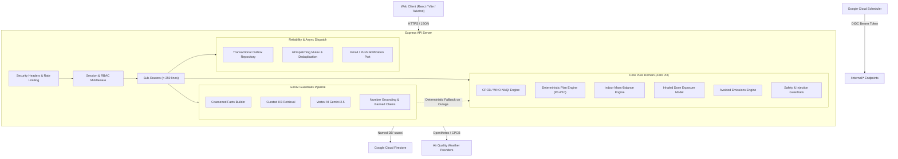
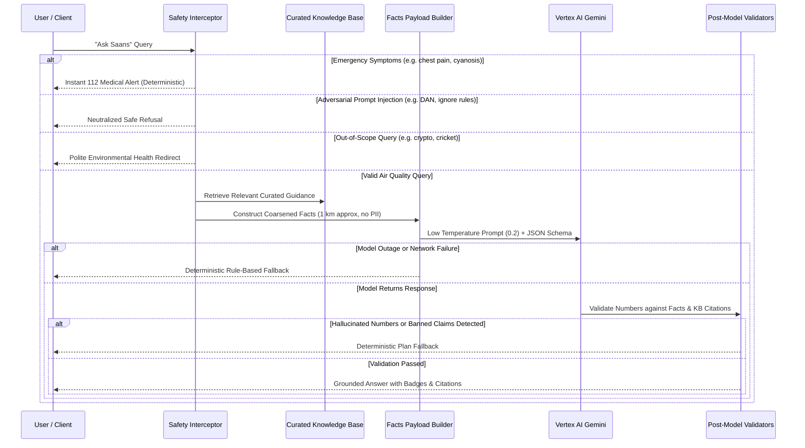

# Saans Architecture Documentation

## 1. System Overview

**Saans** is built on a decoupled, hexagonal (Ports and Adapters) architecture designed to ensure zero-IO purity for core calculations, strict cross-tenant data isolation, and grounded, non-hallucinatory AI assistance.

---

## 2. Hexagonal Ports and Adapters

To guarantee that business logic is completely immune to external API shifts or database changes:

1. **`Clock` Port (`server/src/core/ports/clock.ts`)**:
   - In production: `SystemClock` reads system time.
   - In automated tests and Judge Demo Bar: `FakeClock` allows advancing time (`+15m`, `+1h`, `+6h`) with zero system clock pollution.
   - **Invariable Rule**: `Date.now()` and direct `new Date()` are strictly banned inside domain engines.

2. **`AirQualityProvider` Port (`server/src/core/ports/airProvider.ts`)**:
   - `OpenMeteoProvider`: Fetches real-time ambient PM2.5, PM10, temperature, and relative humidity.
   - `ScenarioProvider`: Provides deterministic test scenarios (`Clean`, `Moderate`, `Poor`, `Severe`, `Hazardous`) for live judging and CI.
   - `ProviderChain`: Chains live upstream with seamless fallback to simulated scenarios on network timeout.

3. **Repository Ports (`server/src/repositories/ports/`)**:
   - `HouseholdRepository`, `CommunityRepository`, `AuditRepository`, `OutboxRepository`.
   - Backed by high-speed in-memory implementations for sub-second CI execution and Firestore implementations for production persistence.

---

## 3. Pure Domain Calculation Engines

All mathematical models in `server/src/core/` are pure TypeScript functions without side effects or I/O:

- **CPCB NAQI & WHO Multiples (`core/aqi.ts`)**: Implements official Indian CPCB piecewise linear interpolation across 6 breakpoints. Computes exact WHO multiple: $\frac{\text{PM2.5}}{15\ \mu\text{g/m}^3}$.
- **Indoor Mass-Balance Physics (`core/indoor.ts`)**:
  $$\frac{dC_{\text{in}}}{dt} = a \cdot C_{\text{out}} - \left(a + k + \frac{\text{CADR}}{V}\right) C_{\text{in}} + \frac{S}{V}$$
  Computes continuous room particle concentration considering wall deposition ($k$), air exchange rate ($a$), room volume ($V$), and filter clean air delivery rate (CADR).
- **Inhaled Dose Exposure Model (`core/exposure.ts`)**:
  $$D = \sum_{i} C_i \cdot V_E \cdot t_i$$
  Calculates microgram PM2.5 lung burden across daily activity microenvironments, displaying uncertainty ranges rather than deceptive single-point numbers.
- **$k$-Anonymity Aggregator (`core/kAnonymity.ts`)**:
  Enforces strict $k \ge 5$ threshold before releasing community-level metrics. RWAs with fewer than 5 active households display an educational anonymity notice.

---

## 4. Grounded GenAI Guardrails Pipeline

---

## 5. Transactional Outbox Pattern

All critical events (smog threshold alerts, co-guardian escalations) write to the `outbox` table in the same transaction as household state updates:

- **Deduplication**: Monotonically assigned `idempotencyKey` prevents duplicate notifications across network retries.
- **Lease Mutex**: Atomic lease acquisition with `isDispatching` flag prevents concurrent Cloud Scheduler instances from double-sending messages.
- **Exponential Backoff**: Up to 3 automatic retries with dead-letter queue isolation for persistent failures.

---

## 6. SOLID Principles Verification

The codebase strictly adheres to the five SOLID design principles across all layers, made visible with direct file links:

1. **Single Responsibility Principle (SRP)**:
   - **Routes parse/validate/respond**: Express sub-routers in [`server/src/routes/`](../server/src/routes/) handle exclusively HTTP request validation and status response mapping (each strictly $< 250$ lines, checked via [`server/scripts/check-router-sizes.js`](../server/scripts/check-router-sizes.js)).
   - **Services hold business rules**: Application services in [`server/src/services/`](../server/src/services/) (e.g. [`auth.service.ts`](../server/src/services/auth.service.ts), [`household.service.ts`](../server/src/services/household.service.ts), [`plan.service.ts`](../server/src/services/plan.service.ts), [`community.service.ts`](../server/src/services/community.service.ts)) coordinate domain logic without HTTP or DB awareness.
   - **Repositories persist**: Ports and adapters in [`server/src/repositories/`](../server/src/repositories/) isolate storage mechanics.
   - **Engines compute**: Pure mathematical calculation engines in [`server/src/core/`](../server/src/core/) ([`aqi.ts`](../server/src/core/aqi.ts), [`indoor.ts`](../server/src/core/indoor.ts), [`exposure.ts`](../server/src/core/exposure.ts), [`emissions.ts`](../server/src/core/emissions.ts), [`planEngine.ts`](../server/src/core/planEngine.ts), [`safety.ts`](../server/src/core/safety.ts)) are 100% pure functions with zero I/O and zero framework dependencies.

2. **Open-Closed Principle (OCP)**:
   - Core behavior is extensible without modifying existing callers through polymorphism, port interfaces, and strategy registries:
     - **Air Quality Providers ([`server/src/adapters/providerChain.ts`](../server/src/adapters/providerChain.ts))**: New weather or municipal air providers implement the [`AirQualityProvider`](../server/src/core/ports/airProvider.ts) port and plug into `ProviderChain` without modifying callers or domain math.
     - **Repositories**: New storage backends plug in by implementing repository ports without modifying services.
     - **Plan Rules Engine ([`server/src/core/planEngine.ts`](../server/src/core/planEngine.ts))**: Rules P1 through P10 are modeled as isolated, prioritized rule evaluators; new municipal directives can be added to the evaluation pipeline without refactoring existing rules.
     - **Impact Calculation Models ([`server/src/core/emissions.ts`](../server/src/core/emissions.ts))**: Emission factors in [`server/src/data/emission-factors.json`](../server/src/data/emission-factors.json) can be calibrated for new vehicle categories or regional grids without altering computation logic.

3. **Liskov Substitution Principle (LSP)**:
   - Derived implementations can be substituted for their abstractions without breaking callers or altering system invariants:
     - **One Contract Test Suite runs against both memory and Firestore repositories**: [`server/tests/repository.contract.test.ts`](../server/tests/repository.contract.test.ts) runs 8 parameterized contract tests identically against [`MemoryHouseholdRepository`](../server/src/repositories/memory/memoryHouseholdRepo.ts) and [`FirestoreHouseholdRepository`](../server/src/repositories/firestore/firestoreHouseholdRepo.ts), guaranteeing identical invariants, mutations, and return types across dev, CI, and Cloud Run environments.
     - **Interchangeable Clocks**: [`SystemClock`](../server/src/adapters/systemClock.ts) (production) and [`FakeClock`](../server/src/adapters/fakeClock.ts) (testing and time-travel judging) are 100% interchangeable across all services and core engines.
     - **Interchangeable Air Providers**: [`OpenMeteoProvider`](../server/src/adapters/openMeteoProvider.ts) and [`ScenarioProvider`](../server/src/adapters/scenarioProvider.ts) both conform to the [`AirQualityProvider`](../server/src/core/ports/airProvider.ts) contract.

4. **Interface Segregation Principle (ISP)**:
   - Interfaces are small, fine-grained, and purpose-specific, ensuring clients never depend on methods they do not need:
     - [`Clock`](../server/src/core/ports/clock.ts): Exposes only `now(): Date`, keeping time consumer dependencies minimal.
     - [`AirQualityProvider`](../server/src/core/ports/airProvider.ts): Exposes only `getCurrent(loc)` and `getForecast(loc, hours)`.
     - [`HouseholdRepository`](../server/src/repositories/ports/householdRepo.ts): Focused on household profiles, memberships, and session lifecycle.
     - [`AuditRepository`](../server/src/repositories/ports/auditRepo.ts) with append-only API: Defines strictly `append()` and `list()`; omits mutative methods (`update`, `delete`) to compile-time guarantee audit immutability.
     - [`OutboxRepository`](../server/src/repositories/ports/outboxRepo.ts): Focused on queueing, transactional leasing (`acquireDispatchLock`), and batch status updates.
     - [`EmailSender`](../server/src/core/ports/emailSender.ts): Minimal single-method port `send(to, subject, body): Promise<boolean>`.
     - [`AiClient`](../server/src/core/ports/aiClient.ts): Decoupled port for generative features (`askSaans`, `mythCheck`, `draftAdvisory`, `draftComplaint`).

5. **Dependency Inversion Principle (DIP)**:
   - Services depend strictly on ports; [`server/src/container.ts`](../server/src/container.ts) is the single composition root that wires concrete adapters:
     - [`server/src/core/`](../server/src/core/) has **zero** dependencies on Express, Firestore, Node.js `fs`, or external SDKs.
     - [`server/src/services/`](../server/src/services/) depend only on abstractions ([`ports`](../server/src/core/ports/)), receiving concrete repository, provider, email, and clock adapters via dependency injection.
     - Express routes depend on domain services and ports wired via [`container.ts`](../server/src/container.ts), never instantiating low-level adapters directly.

---

## 7. Architectural Decision Records (ADRs)

Detailed records of key architectural decisions are documented in the `docs/adr/` directory:

1. [ADR 0001: Clean Hexagonal Architecture & Monorepo Structure](adr/0001-architecture.md)
2. [ADR 0002: Google Cloud Platform Managed Services Selection](adr/0002-gcp-services.md)
3. [ADR 0003: Authentication, Session Management, and Credential Protection](adr/0003-auth-and-sessions.md)
4. [ADR 0004: Air Quality Impact Models and Data Provenance](adr/0004-impact-models.md)
5. [ADR 0005: AI Guardrails, Deterministic Interceptors, and Fallback Strategy](adr/0005-ai-guardrails.md)
6. [ADR 0006: Database Abstraction, Persistence Strategy, and Firestore Integration](adr/0006-database-ports.md)
