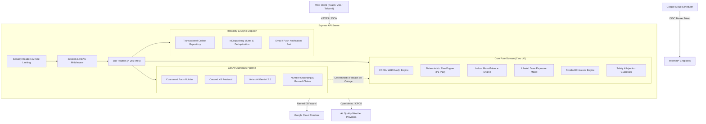
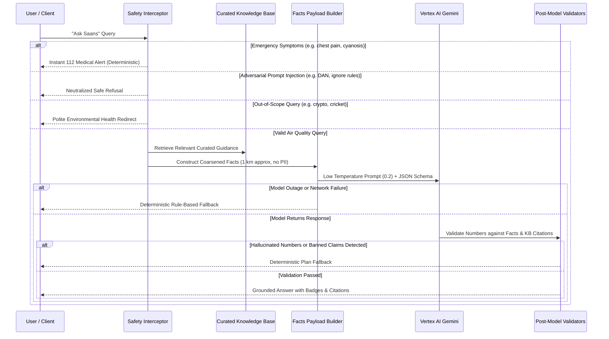

# Saans Architecture Documentation

## 1. System Overview

**Saans** is built on a decoupled, hexagonal (Ports and Adapters) architecture designed to ensure zero-IO purity for core calculations, strict cross-tenant data isolation, and grounded, non-hallucinatory AI assistance.

---

## 2. Hexagonal Ports and Adapters

To guarantee that business logic is completely immune to external API shifts or database changes:

1. **`Clock` Port (`server/src/core/ports/clock.ts`)**:
   - In production: `SystemClock` reads system time.
   - In automated tests and Judge Demo Bar: `FakeClock` allows advancing time (`+15m`, `+1h`, `+6h`) with zero system clock pollution.
   - **Invariable Rule**: `Date.now()` and direct `new Date()` are strictly banned inside domain engines.

2. **`AirQualityProvider` Port (`server/src/core/ports/airProvider.ts`)**:
   - `OpenMeteoProvider`: Fetches real-time ambient PM2.5, PM10, temperature, and relative humidity.
   - `ScenarioProvider`: Provides deterministic test scenarios (`Clean`, `Moderate`, `Poor`, `Severe`, `Hazardous`) for live judging and CI.
   - `ProviderChain`: Chains live upstream with seamless fallback to simulated scenarios on network timeout.

3. **Repository Ports (`server/src/repositories/ports/`)**:
   - `HouseholdRepository`, `CommunityRepository`, `AuditRepository`, `OutboxRepository`.
   - Backed by high-speed in-memory implementations for sub-second CI execution and Firestore implementations for production persistence.

---

## 3. Pure Domain Calculation Engines

All mathematical models in `server/src/core/` are pure TypeScript functions without side effects or I/O:

- **CPCB NAQI & WHO Multiples (`core/aqi.ts`)**: Implements official Indian CPCB piecewise linear interpolation across 6 breakpoints. Computes exact WHO multiple: $\frac{\text{PM2.5}}{15\ \mu\text{g/m}^3}$.
- **Indoor Mass-Balance Physics (`core/indoor.ts`)**:
  $$\frac{dC_{\text{in}}}{dt} = a \cdot C_{\text{out}} - \left(a + k + \frac{\text{CADR}}{V}\right) C_{\text{in}} + \frac{S}{V}$$
  Computes continuous room particle concentration considering wall deposition ($k$), air exchange rate ($a$), room volume ($V$), and filter clean air delivery rate (CADR).
- **Inhaled Dose Exposure Model (`core/exposure.ts`)**:
  $$D = \sum_{i} C_i \cdot V_E \cdot t_i$$
  Calculates microgram PM2.5 lung burden across daily activity microenvironments, displaying uncertainty ranges rather than deceptive single-point numbers.
- **$k$-Anonymity Aggregator (`core/kAnonymity.ts`)**:
  Enforces strict $k \ge 5$ threshold before releasing community-level metrics. RWAs with fewer than 5 active households display an educational anonymity notice.

---

## 4. Grounded GenAI Guardrails Pipeline

---

## 5. Transactional Outbox Pattern

All critical events (smog threshold alerts, co-guardian escalations) write to the `outbox` table in the same transaction as household state updates:

- **Deduplication**: Monotonically assigned `idempotencyKey` prevents duplicate notifications across network retries.
- **Lease Mutex**: Atomic lease acquisition with `isDispatching` flag prevents concurrent Cloud Scheduler instances from double-sending messages.
- **Exponential Backoff**: Up to 3 automatic retries with dead-letter queue isolation for persistent failures.
