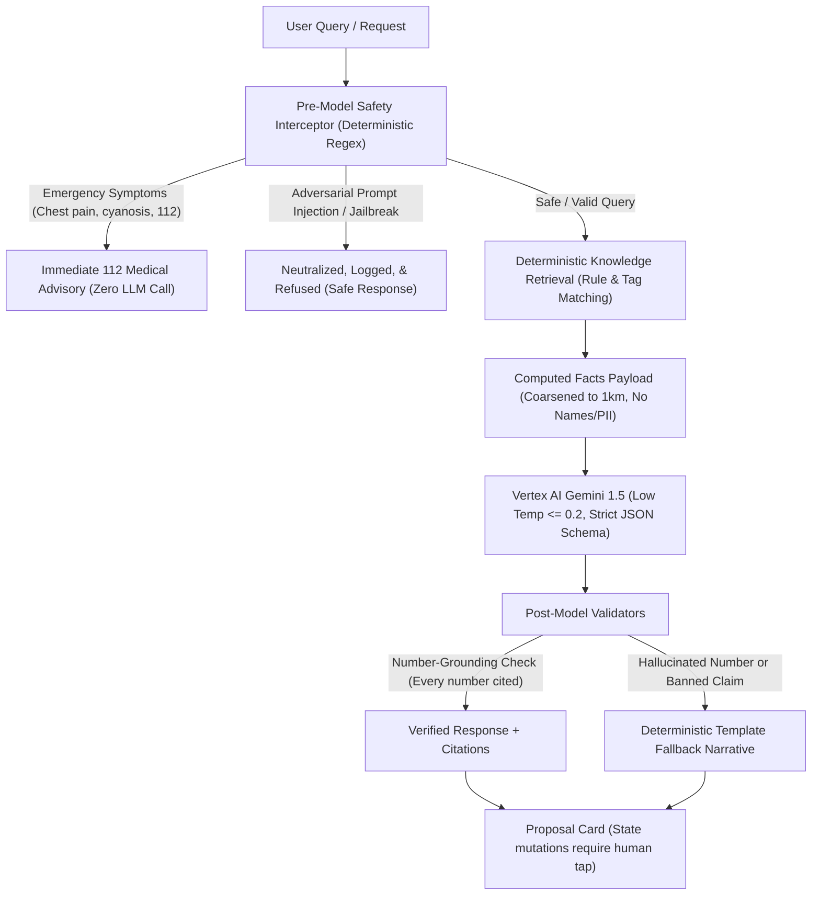

# Saans Security Architecture & Threat Model

> **IMPORTANT MEDICAL NOTICE**: **Saans provides general exposure mitigation and environmental health guidance, NOT prescription medical diagnosis, therapy, or personalized clinical treatment.** Any detection of acute medical emergency symptoms (e.g. severe shortness of breath, cyanosis, chest pain) immediately short-circuits the AI model and provides deterministic guidance to call the national emergency response line (**112 in India**).

---

## 1. STRIDE Threat Model & Security Invariants

Saans applies the STRIDE threat modeling framework across every layer of the hexagonal architecture, validating mitigations through automated security test suites:

| STRIDE Category                | Threat / Risk Scenario                                                                                  | Architectural Countermeasure & Mitigation                                                                                                                                                                                                                         | Verification Test Suite                                                                                  |
| :----------------------------- | :------------------------------------------------------------------------------------------------------ | :---------------------------------------------------------------------------------------------------------------------------------------------------------------------------------------------------------------------------------------------------------------- | :------------------------------------------------------------------------------------------------------- |
| **Spoofing (S)**               | Credential theft, forged bearer tokens, or unauthorized impersonation of household members.             | Opaque 256-bit bearer tokens stored exclusively as SHA-256 hashes with strict expiry timestamps. Passwords hashed using Node `scrypt` with cryptographic salt. Step-up password confirmation required for sensitive actions.                                      | `tests/auth.service.test.ts` `tests/sensitiveOperation.protection.test.ts`                            |
| **Tampering (T)**              | Cross-tenant data tampering, forged Cloud Scheduler triggers, or manipulated alert payloads.            | All repository queries parameterized strictly by `tenantId`. External scheduler endpoints (`/internal/*`) enforce Google Cloud OIDC token verification via `requireOidc` middleware.                                                                              | `tests/crossTenant.isolation.test.ts` `tests/internal.oidc.test.ts`                                   |
| **Repudiation (R)**            | User or admin denying high-stakes actions (household deletion, member revocation, advisory publishing). | Append-only tamper-evident `auditLog` repository (`AuditRepository`) capturing `actor_id`, `action`, `entity_type`, `entity_id`, before/after snapshots, `correlation_id`, and ISO timestamp. Interface strictly omits `update` or `delete` methods.              | `tests/audit.append-only.test.ts`                                                                        |
| **Information Disclosure (I)** | Community surveillance, exposure of sensitive household health flags, or resident location tracking.    | Mathematical $k \ge 5$ anonymity enforced on all community aggregates. Locations coarsened to ~1 km (0.01° grid) prior to storage. AI facts payloads stripped of all names, emails, and exact coordinates. Zero household identifiers exposed in community views. | `tests/community.no-household-leak.test.ts` `tests/kAnonymity.test.ts`                                |
| **Denial of Service (D)**      | Brute-force credential stuffing, API resource exhaustion, or overlapping outbox dispatch collisions.    | 5 consecutive failed logins trigger exponential account and IP lockout, returning HTTP 429 with `Retry-After`. Granular per-IP and per-user rate limiters. Outbox dispatcher protected by atomic in-memory mutex (`isDispatching`) and Firestore lease document.  | `tests/auth.service.test.ts` `tests/rateLimit.test.ts` `tests/outbox.service.test.ts`              |
| **Elevation of Privilege (E)** | Scoped member attempting owner mutations, or adversarial LLM jailbreak bypassing safety barriers.       | Granular 7-scope RBAC enforced via `requirePermission(scope)` middleware with fail-closed deserialization. Multi-stage GenAI guardrails intercept adversarial prompts before calling Vertex AI Gemini.                                                            | `tests/requirePermission.test.ts` `tests/ai.injection.test.ts` `tests/ai.number-grounding.test.ts` |

---

## 2. GenAI Data-Flow & Guardrails Architecture

All generative AI features (Ask Saans, Myth Checker, Community Advisory Composer, Civic Complaint Drafter) strictly follow the deterministic guardrail pipeline:

---

## 3. Sensitive Operation Protection (Section 8)

High-stakes and irreversible operations enforce step-up re-authentication and explicit human confirmation headers:

1. **Household Profile Deletion (`DELETE /api/v1/household/profile`)**:
   - Requires HTTP Header `x-confirm-action: true` (or body `confirmAction: true`).
   - Requires HTTP Header `x-step-up-password: <password>` (or body `stepUpPassword`).
   - Verifies against the user's `scrypt` password hash.
   - Deletes all sessions and appends an immutable audit log entry.
2. **Household Data Export (`POST /api/v1/household/export`)**:
   - Requires HTTP Header `x-confirm-action: true` (or body `confirmAction: true`).
   - Requires HTTP Header `x-step-up-password: <password>` (or body `stepUpPassword`).
   - Validates owner identity and compiles complete household state into an encrypted JSON export.

---

## 4. RBAC Scopes & Permissions Matrix

Saans defines 7 fine-grained permission scopes defined in `shared/src/permissions.ts`:

| Scope    | Description                                                      | Assigned to OWNER |      Assigned to MEMBER       | Assigned to COMMUNITY_ADMIN |
| :------- | :--------------------------------------------------------------- | :---------------: | :---------------------------: | :-------------------------: |
| `READ`   | View live air quality, daily plan, rooms, and household profiles |        Yes        |     Yes (from invitation)     |       Aggregates only       |
| `CREATE` | Toggle action cards, submit community pledges, calculate impact  |        Yes        | Yes (if LOG_ACTIONS granted)  |             Yes             |
| `UPDATE` | Edit household rooms, purifier details, and routine preferences  |        Yes        | Yes (if EDIT_PROFILE granted) |    Yes (society config)     |
| `DELETE` | Delete household or clear sensitive records (step-up required)   |        Yes        |           **Never**           |          **Never**          |
| `INVITE` | Issue cryptographically random SHA-256 invitation tokens         |        Yes        |           **Never**           |  Yes (society join codes)   |
| `REVOKE` | Immediately revoke member sessions with zero grace period        |        Yes        |           **Never**           |    Yes (society members)    |
| `AUDIT`  | Inspect immutable audit trails and compliance logs               |        Yes        |           **Never**           |    Yes (society audits)     |

---

## 5. Security Headers Specification

Every response emitted by the Saans API gateway includes hardened security headers configured via `server/src/middleware/securityHeaders.ts`:

- **Content-Security-Policy (CSP)**: `default-src 'self'; script-src 'self'; style-src 'self'; img-src 'self' data: blob:; connect-src 'self'; font-src 'self'; object-src 'none'; base-uri 'self'; form-action 'self'; frame-ancestors 'none';`
- **Strict-Transport-Security (HSTS)**: `max-age=31536000; includeSubDomains; preload`
- **X-Frame-Options**: `DENY`
- **X-Content-Type-Options**: `nosniff`
- **Referrer-Policy**: `strict-origin-when-cross-origin`
- **Cross-Origin-Opener-Policy**: `same-origin`
- **Cross-Origin-Resource-Policy**: `same-origin`
- **Permissions-Policy**: `geolocation=(self), camera=(), microphone=(), payment=()`
